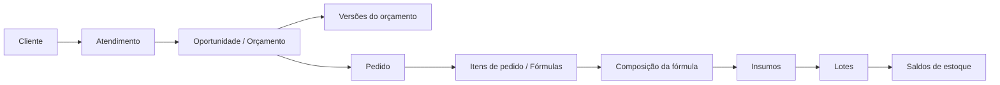
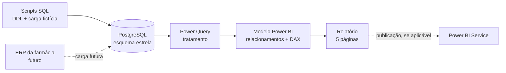
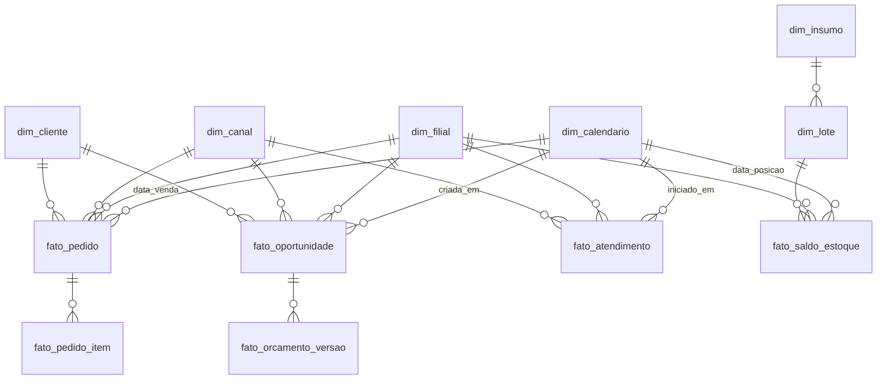

# FarmaBI — Documentação do projeto

> **Projeto:** Business Intelligence para farmácia de manipulação
> **Stack:** Power BI (Desktop / Service) + PostgreSQL
> **Situação:** primeira entrega com **dados demonstrativos / fictícios**; metas e valores devem ser homologados com a farmácia
> **Idioma e formatos:** pt-BR, moeda BRL (R$), datas `dd/mm/aaaa`

---

## Sumário

1. [Visão geral](#1-visão-geral)
2. [Escopo](#2-escopo)
3. [Arquitetura](#3-arquitetura)
4. [Modelo de dados (PostgreSQL)](#4-modelo-de-dados-postgresql)
5. [Modelo no Power BI](#5-modelo-no-power-bi)
6. [Visões e indicadores](#6-visões-e-indicadores)
7. [Regras transversais de consistência](#7-regras-transversais-de-consistência)
8. [Dados demonstrativos de referência](#8-dados-demonstrativos-de-referência)
9. [Validação e critérios de aceite](#9-validação-e-critérios-de-aceite)
10. [Segurança, privacidade e LGPD](#10-segurança-privacidade-e-lgpd)
11. [Plano de desenvolvimento](#11-plano-de-desenvolvimento)
12. [Evoluções futuras](#12-evoluções-futuras)

---

## 1. Visão geral

O **FarmaBI** consolida informações comerciais, de clientes, de atendimento e de estoque de uma farmácia de
manipulação em cinco visões no Power BI, alimentadas por um banco PostgreSQL modelado em esquema estrela.

O negócio tem um ciclo próprio, que o modelo de dados precisa respeitar:



- Um orçamento pode ter várias **versões**, mas é **uma única oportunidade**.
- Um **pedido** pode ter várias **fórmulas** (itens).
- Cada fórmula é composta por várias **matérias-primas**, controladas por **lote** e **validade**.

Na primeira entrega o banco é carregado com dados fictícios. A troca pelos dados do ERP deve exigir apenas uma
nova carga no banco, sem refazer os relatórios.

---

## 2. Escopo

### 2.1 Visões da primeira entrega

| Ordem | Página | Público-alvo | Finalidade |
|---|---|---|---|
| 01 | Executivo e Vendas | Proprietário, diretoria, gerência | Receita, pedidos, ticket médio, crescimento e canais. |
| 02 | Orçamentos e Conversão | Gerência comercial, atendimento | Oportunidades, aprovações, perdas e conversão. |
| 03 | Clientes e Recompra | Comercial, relacionamento, gerência | Aquisição, recorrência, frequência e retenção. |
| 04 | Estoque e Validade | Compras, almoxarifado, produção, gestão | Valor em estoque, mínimo, lotes e vencimentos. |
| 05 | Canais e Atendimento | Supervisão, gerência comercial | Volume, tempo de resposta e eficiência por canal. |

### 2.2 Fora do escopo

Produção e Prazos, Rentabilidade, Qualidade e Rastreabilidade (ver [Evoluções futuras](#12-evoluções-futuras)).
Integração real com o ERP também não faz parte desta entrega.

---

## 3. Arquitetura



| Camada | Responsabilidade |
|---|---|
| PostgreSQL | Armazena fatos e dimensões; views de apoio quando simplificarem o modelo. |
| Scripts SQL | Criação das tabelas, carga determinística dos dados fictícios, consultas de conferência. |
| Power Query | Seleção de colunas, tipos de dados e ajustes leves. Regras de negócio **não** ficam aqui. |
| Medidas DAX | Todas as regras de cálculo dos indicadores, documentadas e reutilizadas entre as páginas. |
| Relatório | Apresentação: cartões, gráficos, tabelas, segmentações e alertas. |

> **Atenção (Power BI Service):** para atualizar no Service um PostgreSQL que roda em máquina local é preciso um
> *on-premises data gateway*. Um banco hospedado em nuvem e acessível pelo Service dispensa o gateway.

### 3.1 Ferramentas

Power BI Desktop, Power Query, DAX, PostgreSQL, SQL, pgAdmin ou DBeaver, Power BI Service (se aplicável),
GitHub, Mermaid e documentação em Word/PDF.

---

## 4. Modelo de dados (PostgreSQL)

### 4.1 Tabelas e granularidade

| Tabela | Tipo | Granularidade | Chave |
|---|---|---|---|
| `dim_calendario` | Dimensão | Um dia | `data` |
| `dim_filial` | Dimensão | Uma unidade | `filial_id` |
| `dim_canal` | Dimensão | Um canal (WhatsApp, Balcão, Site) | `canal_id` |
| `dim_cliente` | Dimensão | Um cliente único | `cliente_id` |
| `dim_insumo` | Dimensão | Uma matéria-prima ou embalagem | `insumo_id` |
| `dim_lote` | Dimensão | Um lote de um insumo | `lote_id` |
| `fato_atendimento` | Fato | Uma conversa/contato iniciado | `atendimento_id` |
| `fato_oportunidade` | Fato | Uma solicitação de orçamento | `oportunidade_id` |
| `fato_orcamento_versao` | Fato | Uma versão de um orçamento | `orcamento_versao_id` |
| `fato_pedido` | Fato | Um pedido comercial | `pedido_id` |
| `fato_pedido_item` | Fato | Uma fórmula de um pedido | `pedido_item_id` |
| `fato_saldo_estoque` | Fato (snapshot) | Um lote × filial × depósito × data de posição | composta |

### 4.2 Diagrama



### 4.3 Colunas mínimas

**`fato_pedido`**

| Coluna | Tipo sugerido | Observação |
|---|---|---|
| `pedido_id` | `varchar` / `bigint` | PK |
| `cliente_id`, `filial_id`, `canal_id` | FK | |
| `oportunidade_id` | FK, opcional | Liga o pedido ao orçamento que o originou. |
| `atendente_id` | opcional | |
| `data_venda` | `date` | Data usada para filtrar vendas. |
| `status` | `varchar` | `CONFIRMADO`, `CANCELADO`, `DEVOLVIDO`. |
| `valor_bruto`, `desconto`, `devolucao`, `valor_liquido` | `numeric(12,2)` | Nunca `float` para valores monetários. |

**`fato_oportunidade`**

| Coluna | Observação |
|---|---|
| `oportunidade_id`, `cliente_id`, `filial_id`, `canal_id`, `atendente_id` | |
| `criada_em` | Data usada para filtrar orçamentos. |
| `data_envio_primeiro_orcamento`, `data_aprovacao` | Base do tempo da primeira cotação. |
| `status` | `PENDENTE`, `CONVERTIDA`, `PERDIDA` (mutuamente exclusivos). |
| `motivo_perda` | `Preço`, `Prazo`, `Sem retorno`, `Outros`. |
| `pedido_id` | Preenchido quando convertida. |

**`fato_atendimento`**

| Coluna | Observação |
|---|---|
| `atendimento_id`, `cliente_id`, `filial_id`, `canal_id`, `atendente_id` | |
| `iniciado_em`, `primeira_resposta_humana_em`, `encerrado_em` | `timestamp`; mensagens automáticas não contam como resposta humana. |
| `status`, `transferencias`, `avaliacao` | |

A relação atendimento → oportunidades é 1:N; guardar `atendimento_id` em `fato_oportunidade` ou usar tabela de
associação, sem multiplicar a contagem de atendimentos.

**`fato_saldo_estoque`**

| Coluna | Observação |
|---|---|
| `data_posicao`, `filial_id`, `deposito_id`, `insumo_id`, `lote_id` | Chave composta. |
| `data_validade`, `data_recebimento` | |
| `saldo_fisico`, `saldo_reservado`, `saldo_bloqueado` | Na unidade de medida do insumo. |
| `custo_unitario` | `numeric`; valorização por lote. |

**`dim_insumo`**: `insumo_id`, `descricao`, `categoria` (Ativos, Bases, Excipientes, Embalagens),
`unidade_medida`, `estoque_minimo`.

> O estoque histórico depende de **snapshots por data de posição** (ou de todas as movimentações para reconstruir o
> saldo). Não unir `fato_pedido` com composição de fórmulas e somar o valor do pedido: isso **duplica faturamento**.

---

## 5. Modelo no Power BI

- Esquema estrela: dimensões filtram fatos em **direção única**; evitar relacionamentos bidirecionais.
- `dim_calendario` marcada como **tabela de datas**, com relacionamentos ativos/inativos para cada data dos fatos.
- Medidas em uma tabela dedicada (ex.: `_Medidas`), organizadas em pastas por visão.
- Divisões sempre com `DIVIDE`, que devolve vazio quando o denominador é zero; o visual exibe **N/D**.
- Segmentações: **Período**, **Filial** e **Canal**. Na página de Estoque, o canal não se aplica: ocultar a
  segmentação ou desligar a interação, e tratar o período como **data de posição**.
- Toda página exibe o aviso **“Dados demonstrativos / fictícios”**, a data de referência e a última atualização.

### 5.1 Medidas de referência (sugestão)

```dax
Vendas Líquidas =
CALCULATE ( SUM ( fato_pedido[valor_liquido] ), fato_pedido[status] = "CONFIRMADO" )

Pedidos Vendidos =
CALCULATE ( DISTINCTCOUNT ( fato_pedido[pedido_id] ), fato_pedido[status] = "CONFIRMADO" )

Ticket Médio = DIVIDE ( [Vendas Líquidas], [Pedidos Vendidos] )

Vendas Mês Anterior = CALCULATE ( [Vendas Líquidas], DATEADD ( dim_calendario[data], -1, MONTH ) )

Crescimento % = DIVIDE ( [Vendas Líquidas], [Vendas Mês Anterior] ) - 1

Oportunidades Geradas = DISTINCTCOUNT ( fato_oportunidade[oportunidade_id] )

Oportunidades Convertidas =
CALCULATE ( [Oportunidades Geradas], fato_oportunidade[status] = "CONVERTIDA" )

Taxa de Conversão % = DIVIDE ( [Oportunidades Convertidas], [Oportunidades Geradas] )
```

> As medidas acima são ponto de partida. Regras como tratamento de devoluções, janela de maturação de
> orçamentos e política de atribuição de canal devem ser confirmadas com a farmácia antes de fechadas.
> Note que `Crescimento %` precisa tratar o caso sem mês anterior (ex.: `IF ( ISBLANK ( [Vendas Mês Anterior] ), BLANK (), ... )`).

---

## 6. Visões e indicadores

### 6.1 Visão 01 — Executivo e Vendas

| Indicador | Regra de cálculo | Observação |
|---|---|---|
| Vendas líquidas comerciais | Valor vendido − descontos − devoluções/cancelamentos aplicáveis | Não é receita líquida contábil. |
| Pedidos vendidos | `COUNT(DISTINCT pedido_id)` válidos | Pedido com 2 fórmulas conta 1 vez. |
| Ticket médio | `vendas_liquidas / pedidos_vendidos` | Sem pedidos → N/D. |
| Crescimento (%) | `(vendas_atual / vendas_anterior − 1) × 100` | Mesmo recorte de filial/canal. |
| Clientes compradores | `COUNT(DISTINCT cliente_id)` | Complementar. |
| Fórmulas vendidas | Quantidade de itens válidos | ≠ pedidos. |
| Atingimento de meta (%) | `vendas / meta × 100` | Só se houver metas cadastradas. |

**Visuais:** 4 cartões (vendas, pedidos, ticket, crescimento) · linha de vendas por mês · rosca de participação por
canal · tabela por canal (pedidos, receita, participação %).

### 6.2 Visão 02 — Orçamentos e Conversão

| Indicador | Regra de cálculo |
|---|---|
| Orçamentos gerados | Oportunidades distintas criadas no período (revisões não contam). |
| Orçamentos convertidos | Oportunidades vinculadas a pedido válido confirmado. |
| Taxa de conversão (%) | `convertidas / elegíveis × 100` |
| Em negociação | Abertas e sem desfecho. |
| Orçamentos perdidos | Encerradas sem conversão. |
| Taxa de perda (%) | `perdidas / encerradas × 100` |
| Tempo médio da 1ª cotação | Média de `data_envio_primeiro_orcamento − data_solicitacao`. |

**Visuais:** 4 cartões (gerados, convertidos, conversão, em negociação) · barras por etapa (gerados, enviados,
aprovados, perdidos, pendentes) · motivos de perda · tabela de conversão por canal.

**Regras:** `geradas = convertidas + perdidas + pendentes`; janela de maturação sugerida de 30 dias; política de
atribuição por atendente (original ou fechamento) precisa ser definida.

### 6.3 Visão 03 — Clientes e Recompra

| Indicador | Regra de cálculo |
|---|---|
| Clientes compradores | `COUNT(DISTINCT cliente_id)` com compra válida no período. |
| Novos clientes | Primeira compra válida no período (não a data de cadastro). |
| Clientes recorrentes | Compraram no período e já tinham comprado antes. |
| Recompra em 90 dias (%) | Clientes da coorte que recompraram em até 90 dias / clientes elegíveis da coorte. |
| Frequência de compra | Pedidos por cliente no período. |
| Ticket médio por cliente | Vendas líquidas / compradores. |
| Dias entre compras | Média dos intervalos entre compras consecutivas. |
| Inativos | Sem compra há mais de N dias (configurável). |

**Visuais:** 4 cartões (compradores, novos, recorrentes, recompra 90d) · colunas novos × recorrentes por mês ·
barras de frequência (1, 2, 3+) · tabela por canal (compradores, novos, recompra).

**Regras:** `compradores = novos + recorrentes`; recorrência mensal e recompra de coorte são conceitos distintos;
usar só coortes que completaram 90 dias.

### 6.4 Visão 04 — Estoque e Validade

| Indicador | Regra de cálculo |
|---|---|
| Valor em estoque | Σ (saldo do lote × custo unitário do lote). |
| Insumos abaixo do mínimo | Insumos distintos com saldo disponível < mínimo. |
| Lotes vencendo em 30 dias | Lotes não vencidos com validade nos próximos 30 dias **da data de posição**. |
| Valor em risco | Valor dos lotes próximos do vencimento. |
| Lotes vencidos | `data_validade < data_posicao` e saldo registrado. |
| Consumo mensal | Σ saídas para consumo no período. |
| Cobertura (dias) | Saldo disponível / consumo médio diário. |
| Giro de estoque | Custo do consumo / estoque médio valorizado. |

**Visuais:** 4 cartões (valor, abaixo do mínimo, vencendo em 30 dias, valor em risco) · alerta de lotes vencidos ·
barras por faixa de validade (vencidos, 0–30, 31–60, 61–90, >90) · rosca por categoria · tabela de lotes.

**Regras:** lotes em quarentena, bloqueados ou vencidos não compõem o saldo disponível; converter unidades antes
de agregar; os alertas são gerenciais — a decisão de uso ou descarte é do farmacêutico responsável.

### 6.5 Visão 05 — Canais e Atendimento

| Indicador | Regra de cálculo |
|---|---|
| Atendimentos | Atendimentos distintos iniciados no período. |
| Tempo de primeira resposta | Média entre chegada do contato e primeira resposta **humana**. |
| Orçamentos gerados | Oportunidades vinculadas aos atendimentos do canal. |
| Conversão por canal (%) | Mesma definição da Visão 02, por canal. |
| Vendas por canal | Valor vendido atribuído ao canal conforme política definida. |
| Sem resposta | Contatos sem resposta dentro do limite configurado. |
| Tempo total | Média entre início e encerramento. |
| Satisfação | Avaliação média, se houver coleta. |

**Visuais:** 4 cartões (atendimentos, 1ª resposta média, orçamentos, conversão) · barras de volume por canal ·
barras de conversão por canal · tabela de eficiência.

**Regras:** um atendimento com vários orçamentos conta uma vez; horário comercial precisa de tratamento explícito
para SLA; definir atribuição em transferências entre atendentes.

---

## 7. Regras transversais de consistência

1. Pedidos ≠ itens ≠ fórmulas ≠ lotes ≠ atendimentos: cada medida na sua granularidade.
2. Contagens com `DISTINCTCOUNT` sobre o ID correto.
3. Orçamentos contam oportunidades, não versões.
4. Cada indicador usa sua data: venda, criação da oportunidade, início do atendimento ou posição do estoque.
5. Devoluções e cancelamentos seguem regra documentada.
6. Clientes únicos não são a soma dos canais (o mesmo cliente pode comprar em mais de um).
7. Taxas a partir de numerador e denominador agregados — **nunca média de percentuais**.
8. Tempos médios ponderados pelo número de atendimentos válidos.
9. Divisão por zero → **N/D**.
10. Validade comparada com a data de posição selecionada, nunca com a data atual.
11. Valores monetários em `numeric` no banco; formatação só no relatório.
12. Filtro sem correspondência → visual vazio, nunca o total geral.
13. Metas ou indicadores indisponíveis não viram zero silenciosamente.

---

## 8. Dados demonstrativos de referência

> **Todos os valores são fictícios** e servem para validar o modelo e os relatórios. A carga deve gerar
> **registros** cujas agregações reproduzam estes números, e não totais fixos.

### 8.1 Por mês e canal (todas as filiais)

| Mês | Canal | Vendas líquidas (R$) | Pedidos | Orçamentos | Atendimentos | Compradores | Novos | 1ª resposta (min) | Recompra 90d (%) |
|---|---|---:|---:|---:|---:|---:|---:|---:|---:|
| Ago/26 | WhatsApp | 88.800 | 627 | 930 | 1.100 | 485 | 139 | 5,8 | 41,4 |
| Ago/26 | Balcão | 42.300 | 308 | 410 | 493 | 235 | 64 | 2,6 | 40,2 |
| Ago/26 | Site | 19.900 | 139 | 231 | 278 | 103 | 40 | 1,6 | 38,7 |
| Set/26 | WhatsApp | 95.600 | 652 | 972 | 1.165 | 503 | 143 | 5,6 | 42,1 |
| Set/26 | Balcão | 46.100 | 332 | 436 | 525 | 252 | 67 | 2,5 | 41,3 |
| Set/26 | Site | 22.700 | 143 | 238 | 290 | 113 | 42 | 1,5 | 39,8 |
| Out/26 | WhatsApp | 108.300 | 729 | 1.080 | 1.280 | 553 | 160 | 5,4 | 43,2 |
| Out/26 | Balcão | 51.200 | 358 | 470 | 560 | 265 | 76 | 2,3 | 42,1 |
| Out/26 | Site | 25.900 | 161 | 262 | 320 | 128 | 51 | 1,4 | 41,1 |

**Totais de outubro/2026:** vendas R$ 185.400 · pedidos 1.248 · ticket ≈ R$ 148,56 · orçamentos 1.812 ·
conversão ≈ 68,87% · atendimentos 2.160 · crescimento sobre setembro (R$ 164.400) ≈ 12,77%.

Compradores (946) e novos (287) somados por canal só valem como total global se nenhum cliente comprar em mais de
um canal; no modelo, o total global vem de `DISTINCTCOUNT(cliente_id)`.

A divisão 62% matriz / 38% unidade 02 do protótipo original é apenas simplificação: na carga, atribuir a filial a
cada registro e agregar depois.

### 8.2 Frequência de compras — outubro/2026

| Canal | 1 compra | 2 compras | 3+ compras |
|---|---:|---:|---:|
| WhatsApp | 413 | 104 | 36 |
| Balcão | 188 | 61 | 16 |
| Site | 99 | 25 | 4 |

### 8.3 Estoque (todas as filiais)

| Posição | Valor em estoque | Abaixo do mínimo | Vencendo em 30 dias | Valor em risco | Vencidos |
|---|---:|---:|---:|---:|---:|
| 31/08/26 | R$ 263.800 | 19 | 13 | R$ 10.900 | 2 |
| 30/09/26 | R$ 274.600 | 20 | 14 | R$ 12.400 | 3 |
| 31/10/26 | R$ 283.400 | 23 | 17 | R$ 14.800 | 4 |

**Valor por categoria (31/10/26):** Ativos R$ 128.000 · Bases R$ 72.100 · Excipientes R$ 51.900 ·
Embalagens R$ 31.400 · **Total R$ 283.400**.

**Lotes por faixa (31/10/26):** vencidos 4 · 0–30 dias 17 · 31–60 dias 22 · 61–90 dias 31 · >90 dias 158.

**Amostra de lotes vencendo (31/10/26):**

| Insumo | Lote | Saldo | Validade |
|---|---|---|---|
| Magnésio bisglicinato | MP-1038 | 1,2 kg | 07/11/2026 |
| Niacinamida | MP-1042 | 2,4 kg | 13/11/2026 |
| Vitamina D3 | MP-0992 | 0,6 kg | 21/11/2026 |
| Base creme não iônica | BS-1085 | 5,8 kg | 28/11/2026 |

### 8.4 Motivos de perda

Preço 41% · Prazo 24% · Sem retorno 21% · Outros 14%. Na carga, gerar contagens inteiras cuja soma seja igual
ao total de oportunidades perdidas do recorte.

---

## 9. Validação e critérios de aceite

A validação compara cada medida DAX com uma **consulta SQL de referência** no PostgreSQL, por exemplo:

```sql
-- Vendas líquidas e pedidos de outubro/2026 (esperado: 185400.00 e 1248)
SELECT SUM(valor_liquido)          AS vendas_liquidas,
       COUNT(DISTINCT pedido_id)   AS pedidos
FROM   fato_pedido
WHERE  status = 'CONFIRMADO'
AND    data_venda >= DATE '2026-10-01'
AND    data_venda <  DATE '2026-11-01';
```

### 9.1 Consistência (outubro/2026, sem filtros de filial/canal)

- [ ] Vendas líquidas = **R$ 185.400**
- [ ] Pedidos = **1.248**
- [ ] Ticket médio ≈ **R$ 148,56**
- [ ] Orçamentos = **1.812**
- [ ] Conversão ≈ **68,87%**
- [ ] Atendimentos = **2.160**
- [ ] Estoque em 31/10/2026 = **R$ 283.400**
- [ ] Lotes vencendo em 30 dias = **17**
- [ ] Soma das vendas por canal = total do período
- [ ] Convertidas + perdidas + pendentes = geradas
- [ ] Pedidos não aumentam ao cruzar com itens/fórmulas
- [ ] Cliente que compra em dois canais não é duplicado no total
- [ ] Recompra 90d usa apenas coortes maduras
- [ ] Lotes vencidos não aparecem como disponíveis
- [ ] Indicadores sem denominador exibem N/D

### 9.2 Funcionais

- [ ] Navegação entre as cinco páginas, com Executivo e Vendas como inicial
- [ ] Período padrão: outubro/2026
- [ ] Segmentações de período, filial e canal atualizam cartões, gráficos e tabelas
- [ ] Canal não distorce a página de Estoque
- [ ] Todos os cartões com título, valor formatado em pt-BR e contexto (mês, posição ou janela)
- [ ] Aviso “Dados demonstrativos / fictícios” em todas as páginas
- [ ] Mensagem adequada quando o filtro não retorna registros

---

## 10. Segurança, privacidade e LGPD

- Nenhum dado real de paciente no ambiente demonstrativo.
- Painéis gerais não exibem tratamentos, diagnósticos ou prescrições identificáveis.
- Credenciais do PostgreSQL **fora** do repositório e do arquivo `.pbix` versionado.
- Ao integrar com o ERP: usuário de banco somente leitura, permissões por perfil e, se publicado, segurança em nível
  de linha (RLS) no Power BI quando necessário.
- Conformidade com a **LGPD (Lei 13.709/2018)**; controles de manipulação e rastreabilidade seguem a
  **RDC Anvisa 67/2007** e normas aplicáveis. O BI não substitui registros operacionais nem decisões do
  farmacêutico responsável.

---

## 11. Plano de desenvolvimento

| Etapa | Atividade | Produto |
|---|---|---|
| 1 | Definição do escopo e validação dos indicadores com a farmácia | Indicadores homologados |
| 2 | Modelagem do banco em esquema estrela | Scripts DDL e diagrama |
| 3 | Carga dos dados fictícios | Scripts de carga e consultas de conferência |
| 4 | Conexão do Power BI, tabela calendário e medidas DAX | Modelo semântico |
| 5 | Páginas 01 a 03 (Executivo, Orçamentos, Clientes) | Relatório parcial |
| 6 | Páginas 04 e 05 (Estoque, Canais) | Relatório completo |
| 7 | Conferência DAX × SQL e validação com a instituição | Checklist da seção 9 |
| 8 | Documentação, dicionário de indicadores e evidências | Entrega final |

Responsáveis e prazos estão na proposta da Entrega 1 ([Entrega1_FarmaBI_Grupo9.docx](Entrega1_FarmaBI_Grupo9.docx)).

---

## 12. Evoluções futuras

1. **Produção e Prazos:** ordens em aberto, fórmulas concluídas, tempo por etapa, atrasos e retrabalho.
2. **Rentabilidade:** margem bruta e de contribuição, custo por fórmula, descontos, lucratividade por categoria.
3. **Qualidade e Rastreabilidade:** liberações, reprovações, não conformidades, rastreio de insumos por lote.
4. **Análises avançadas:** previsão de demanda de insumos, coortes, RFM, desempenho por atendente, alertas
   configuráveis, receita × meta por filial.

O modelo estrela deve receber essas extensões com novas tabelas fato, reaproveitando as dimensões existentes.
